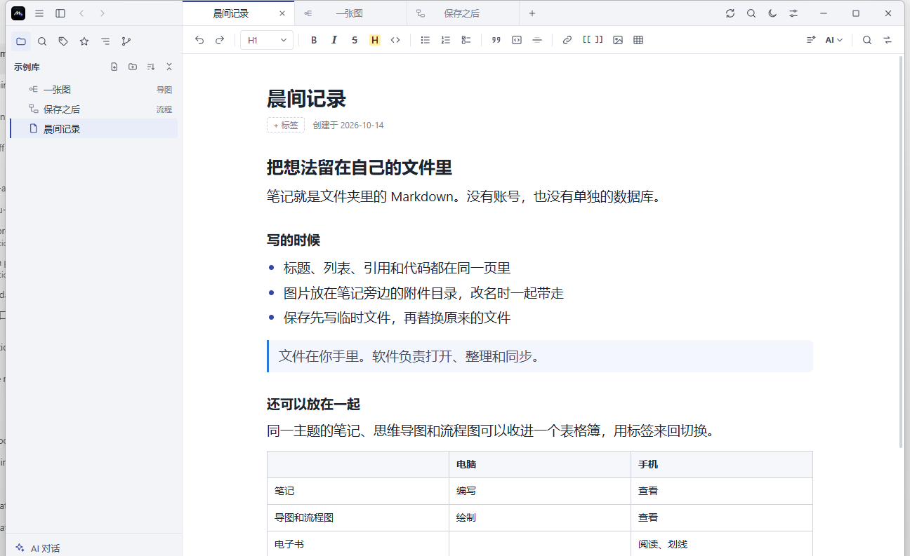
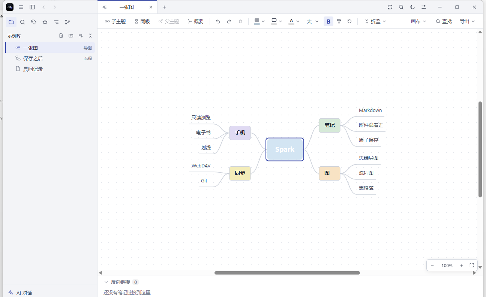
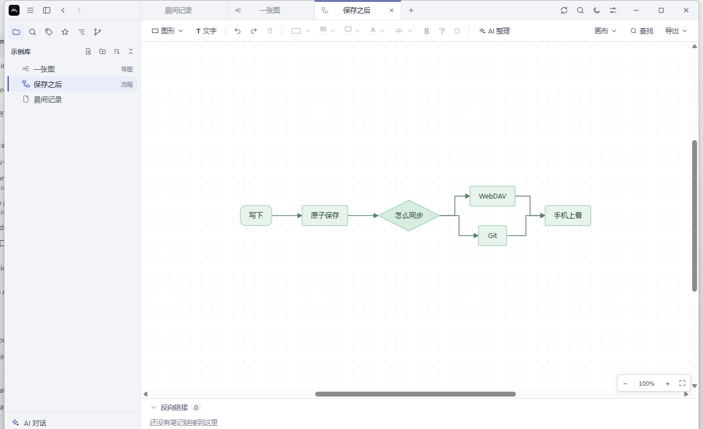
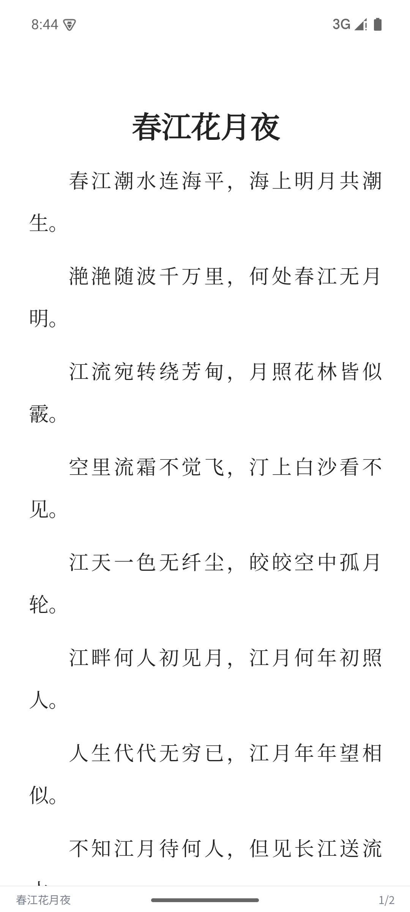

# Spark

小巧、性能强的 Windows / macOS 桌面端 Markdown 笔记软件，笔记以本地 Markdown 文件保存。实测安装包不到 5MB，冷启动不到半秒；打开一万篇笔记的库后，应用内存约 100MB，搜索仍是毫秒级。以 [MIT 许可证](LICENSE) 发布。

<p align="center">
  
</p>
<p align="center">
  
  
</p>
<p align="center">
  
</p>

支持 Windows 与 macOS 13 及以上版本。AI 的 API Key、WebDAV 密码和 Git 远程账号在 Windows 上写入凭据管理器，在 macOS 上写入钥匙串。安卓只读版的 WebDAV 密码写入系统密钥库。

需求见 [docs/需求文档.md](docs/需求文档.md)，界面定稿设计稿见 [prototype/index.html](prototype/index.html)（风格 A，浅色 + 夜读）。改进代码的方式见 [CONTRIBUTING.md](CONTRIBUTING.md)：先 Fork，再提交 Pull Request。安全漏洞按 [SECURITY.md](SECURITY.md) 私下报告。

## 下载

Windows 64 位安装包在 [Releases](https://github.com/HeiGouda/spark-notes/releases/latest)，下载后直接安装。安装包未签名，若 Windows 提示“Windows 已保护你的电脑”，点“更多信息”，再点“仍要运行”。macOS 安装包尚未提供。

安卓版可以查看笔记，也可以管理云端书架、阅读电子书（EPUB、TXT、MOBI、AZW3、PDF）、划线记笔记，并使用单独配置的 AI 对话。普通笔记、导图和流程图不能编辑，只能删除（可以选是否同时删除云端文件）。签名 APK 在 Gitee 的 [Releases](https://gitee.com/auricular-zhong/spark-notes/releases)（包名 `com.spark.app`，支持 arm64、armv7、x86 和 x86_64）。签名密钥不在仓库里，丢了就不能覆盖升级已安装的正式版。

## 技术栈

Tauri 2（Rust）+ Vue 3 + TypeScript + Pinia，编辑器 Milkdown，代码高亮 Prism（`@milkdown/plugin-prism` + refractor），一键整理的中英文空格用 `pangu`，AI 对话的 Markdown 显示用 `markdown-it`。

## 开发环境

- Node.js 20+（npm）
- Rust stable（`rustup`）
- Windows：目标 `x86_64-pc-windows-msvc`，Visual Studio 2022 Build Tools（“使用 C++ 的桌面开发”工作负载），WebView2 运行时（Windows 11 自带）
- macOS：Xcode 命令行工具（`xcode-select --install`）；打通用包还需 `rustup target add aarch64-apple-darwin x86_64-apple-darwin`

## macOS 差异

- 窗口使用系统的红黄绿按钮（`src-tauri/tauri.macos.conf.json`），菜单栏提供剪切 / 复制 / 粘贴 / 全选、隐藏、最小化；`Cmd+Q` 先保存笔记再退出，与关闭窗口的流程相同。
- 快捷键里的 Ctrl 对应 Cmd、Alt 对应 Option。和系统冲突的几项改用 macOS 习惯的默认值：重做 `Cmd+Shift+Z`、替换 `Cmd+Option+F`、切换标签页 `Cmd+Shift+]` / `Cmd+Shift+[`、后退 / 前进 `Cmd+[` / `Cmd+]`、引用 `Cmd+Option+Q`。`Cmd+Q`、`Cmd+H`、`Cmd+M`、`Cmd+Tab` 等不能设为快捷键。文件树里 `Cmd+Backspace` 删除。
- Git 依次查找 `PATH`、`/opt/homebrew/bin/git`、`/usr/local/bin/git`；没装命令行工具时 `/usr/bin/git` 会弹出系统的安装提示。
- 没有 Mac 时，可在 GitHub Actions 手动运行“构建 macOS 安装包”，下载产物里的 `.dmg`。安装包未签名，首次打开需在访达里右键“打开”。

## 常用命令

| 命令 | 说明 |
| --- | --- |
| `npm install` | 安装前端依赖 |
| `npm run tauri dev` | 开发模式运行 |
| `npm test` | 前端单元测试（Vitest） |
| `npx vue-tsc --noEmit` | 类型检查 |
| `cargo test`（在 `src-tauri/` 下） | Rust 单元测试 |
| `npm run tauri build` | 打包发布版（`src-tauri/target/release/bundle/` 下：Windows 为 MSI 与 NSIS 安装包，安装界面为简体中文；macOS 为 `.app` 与 `.dmg`） |
| `npm run tauri build -- --target universal-apple-darwin` | macOS 通用包（Apple 芯片 + Intel） |

## 服务器 WebDAV

在已经用 Caddy 提供 HTTPS 的 Ubuntu 上部署，不是 Docker。部署、多库、电脑和手机同步、笔记柜的回收站和账号，见 [docs/webdav.md](docs/webdav.md)。

```bash
sudo DOMAIN=example.com WEBDAV_USER=账号 WEBDAV_PASSWORD=密码 ./deploy/webdav/install.sh
```

软件和浏览器都用 `https://域名/dav`。多个库靠远端目录区分，例如 `spark/工作`。密码写在服务器的 `/var/lib/notes-cabinet/webdav.passwd`，不要放进这个仓库。

## 性能验收

需求文档 7.1 的指标用 `scripts/perf/` 中的脚本测量，需要先 `npm run tauri build` 得到发布版：

```powershell
node scripts/perf/gen-vault.mjs $env:TEMP\spark-perf        # 生成 1 万篇笔记（一半带图片）的测试库
node scripts/perf/bench.mjs src-tauri\target\release\Spark.exe $env:TEMP\spark-perf vault   # 完整流程
node scripts/perf/bench.mjs src-tauri\target\release\Spark.exe $env:TEMP\spark-perf idle    # 打开笔记库后的内存
node scripts/perf/bench.mjs src-tauri\target\release\Spark.exe $env:TEMP\spark-perf empty   # 空闲内存
```

- 运行前关闭 Spark。`bench.mjs` 会临时改写应用设置让程序打开测试库，结束（包括出错、Ctrl+C）时自动恢复。
- `gen-vault.mjs` 只会清空空目录或它自己生成过的测试库，不会清空其他目录。
- 内存按“Spark 进程 + WebView2 页面进程”统计；输出里也列出了 WebView2 其他进程，供参考。

## 数据安全约定

- 保存采用“写临时文件并落盘 → 重命名覆盖”的原子写入。
- 打开笔记时把 YAML Front Matter 原样切出，编辑器只处理正文，保存时原样拼回；同时保留原文件的换行符（LF / CRLF）。
- 只打开不编辑不会写回文件。
- 所有失败都在状态栏提示；关闭标签页或退出时如有保存失败的笔记，会先询问是否放弃修改。
- 重命名、移动、删除之前先保存受影响的已打开笔记；笔记的 `笔记名.assets/` 附件目录始终随笔记一起改名、移动和删除，改名时正文里的附件引用同步改写。
- 删除需确认，移入 `.ttnote/trash/<时间戳>/`（保留原相对路径，并写 `meta.json` 记录原位置）。
- 空段落不写成 `<br />`，保存结果保持纯 Markdown。
- 图片通过 asset 协议显示，只放行当前打开的笔记库目录。
